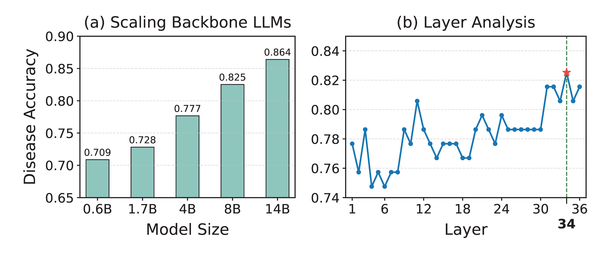

# Supplementary Experiments
## 📊 Ablation study

Ablation study results on three medical consultation datasets. DAcc denotes diagnosis accuracy; SRec denotes the recall of implicit symptoms; ATurn denotes the average number of symptom inquiry turns; Rtime denotes the inference cost

## ✨ Backbone LLMs and Influence of Representation Layers

Performance comparison of DiffDiag on the Medical Consultation task of the DXY dataset, including backbone LLMs with different parameter scales and diagnostic probing at different hidden layers.

## ⚖️ Human Expert Evaluation
For more details on the human expert evaluation, please [click here](Human_Expert_Evaluation.md).

