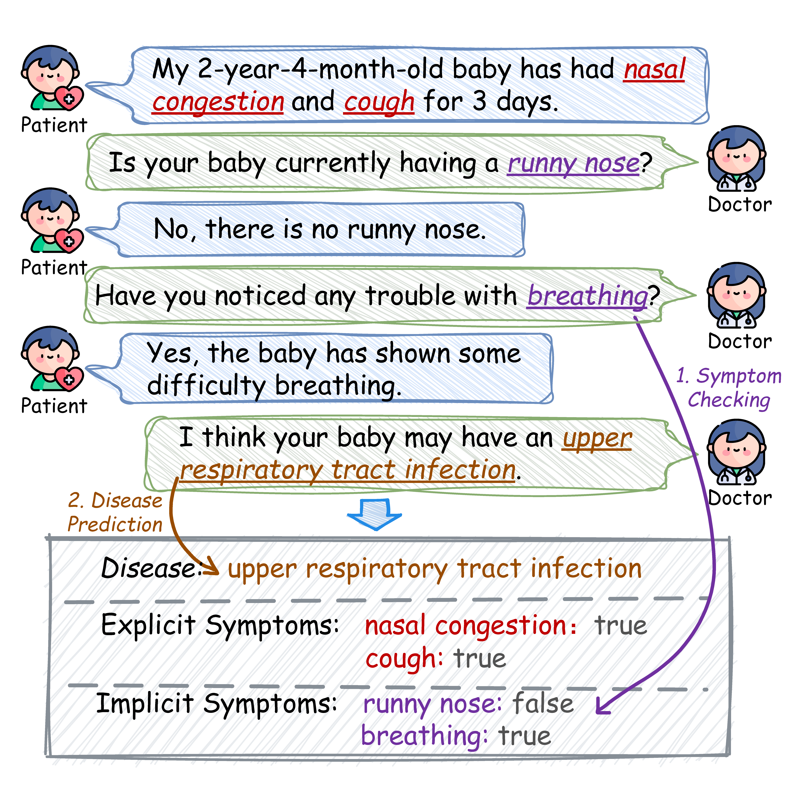
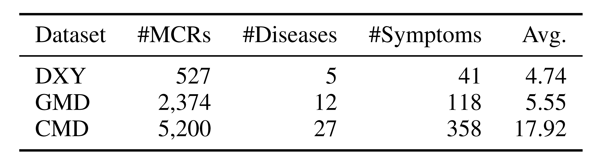

<div align="center">
  
</div>

<p float="left"> 

# DiffDiag
This repository provides an implementation of the paper **“DiffDiag: Diffusion-Guided Symptom Inquiry for LLM-based Medical Consultation.”** It includes the data processing pipeline, source code, experimental results, and detailed usage instructions to support reproducible research and future extensions. The repo covers the full **DiffDiag** framework for automated medical consultation, including the **Latent Diffusion Symptom Generator** for selecting informative follow-up symptoms, and the **Probing-based Disease Diagnosis** module for predicting diseases from internal LLM representations rather than free-form generation, together with evaluation scripts and reproducibility materials.

<div align="center">
  
</div>

## 📂 Dataset Overview
<div align="center">
  
</div>

### Medical Consultation Datasets

We evaluate **DiffDiag** on three real-world medical consultation datasets. Each record contains the patient's initially reported explicit symptoms, implicit symptoms that can be collected through follow-up inquiries, and the corresponding disease label:

- **DXY** — an online medical dialogue dataset containing **527** consultation records, **5** diseases, and **41** symptoms.
- **GMD** — an electronic medical record-based consultation dataset containing **2,374** consultation records, **12** diseases, and **118** symptoms.
- **CMD** — a large-scale medical consultation dataset containing **5,200** consultation records, **27** diseases, and **358** symptoms.

**For more detailed dataset descriptions, please [click here](data).**

## 🧠 DiffDiag Framework
<div align="center">
  
</div>

Architecture of DiffDiag. The Doctor-Patient Consultation Simulation module maintains shared consultation memory through multi-turn interactions; the Latent Diffusion Symptom Generator denoises latent symptom representations to select informative inquiries; and the Probing-based Disease Diagnosis module probes frozen LLM hidden states to predict the disease or trigger further inquiry.

## 📊 Results
<div align="center">
  
</div>

Performance comparison on three medical consultation datasets. Best and second-best main results are highlighted in bold and underlined. DiffDiag-MI is an exploratory multi-symptom variant. Ttime/Rtime denote total training time and per-case inference time; m/s denote minutes/seconds.

**For comprehensive details on all baseline models, please [Click here.](Doc/Supplementary%20Experiments/Baseline.md)**

**For more detailed results, please [Click here.](Doc/Supplementary%20Experiments/README.md)**


## 📖 Usage
You can implement our methods according to the following steps:

1. Install the necessary packages. Run the command:
   ```shell
   pip install -r requirements.txt
   ```
2. Run our code using Python.

   Data Augmentation:
   ```shell
   bash data/run_all.sh
   ```
   
   Train the Diffusion:
   ```shell
   bash Diffusion/run.sh
   ```

   Train the probe:
   ```shell
   bash probe/run.sh
   ```

## 🌟 Contributions and suggestions are welcome!
